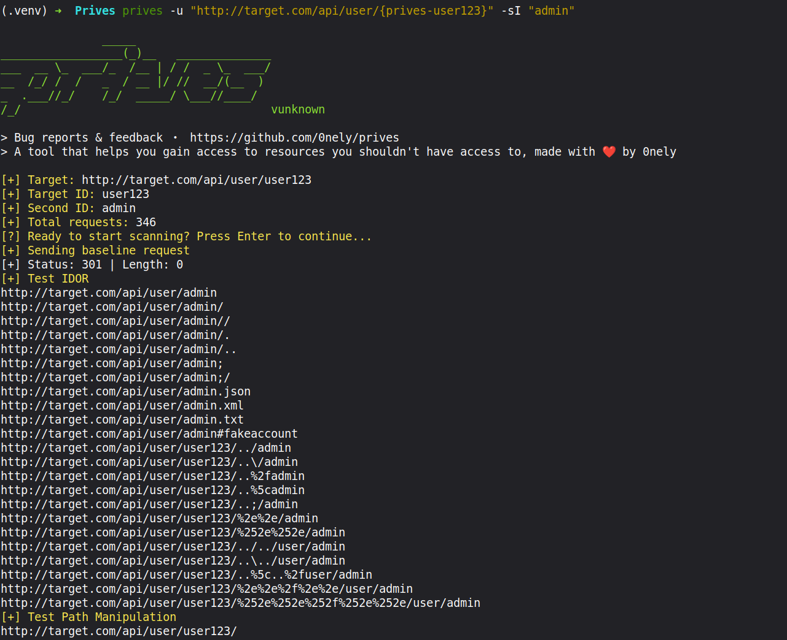

# Prives

Prives is a security testing tool designed to identify potential Broken Access Control (BAC) vulnerabilities in web applications and APIs.

It automates various request manipulation techniques to help security researchers discover access control weaknesses and assess authorization behavior.



## Key Techniques

- **IDOR** – Tests for insecure direct object references and unauthorized object access.
- **Authorization Bypass** – Tests alternative request formats, headers, and path manipulation techniques to identify potential authorization bypasses, particularly on endpoints returning HTTP 401 or 403.

## Installation

### pipx

```bash
# Install
pipx install prives

# Upgrade
pipx upgrade prives

# Uninstall
pipx uninstall prives
```

### pip

```bash
# Install
pip install prives

# Upgrade
pip install --upgrade prives

# Uninstall
pip uninstall prives
```

## Usage

### Basic Scan

```bash
prives -u https://target.com
```

### Specify Target ID

```bash
prives -u https://target.com/api/user/{prives-user123}
```

### Enable IDOR Testing

```bash
prives -u https://target.com/api/user/{prives-user123} -sI "admin"
```

For more options and available techniques:

```bash
prives --help
```

## Bug Reports & Feedback

Bug reports, suggestions, and feedback are always welcome. Feel free to open an issue or share your thoughts. I'd be happy to hear from you!

## Legal Disclaimer

Prives is intended for authorized security testing, educational purposes, and security research only.

Users are responsible for ensuring they have proper authorization before testing any application or system.

The developers assume no responsibility for misuse, unauthorized access, or any damage resulting from the use of this tool.

## License

This project is licensed under the MIT License. See the [LICENSE](LICENSE) file for details.